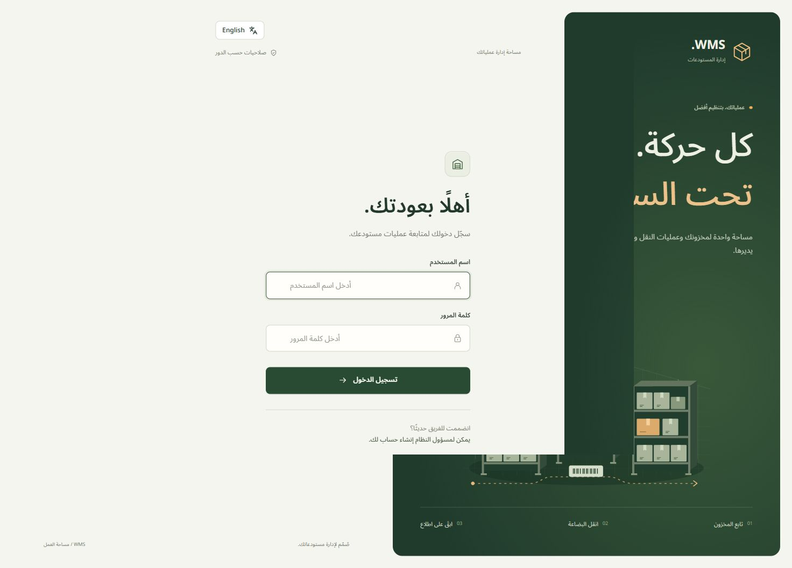
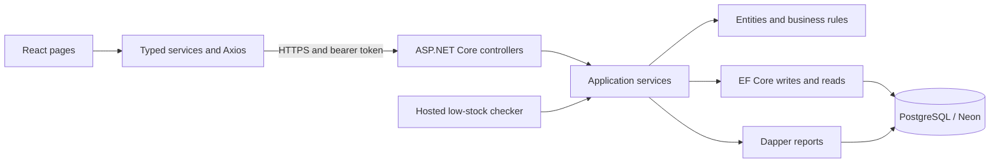

# Warehouse Management System

A full-stack application for managing products, warehouses, stock movements, and warehouse-to-warehouse transfers. It combines a bilingual React interface with an ASP.NET Core API, PostgreSQL transactions, inventory audit trails, and periodic low-stock detection.

**[Live application](https://wms-solution.vercel.app/login)** · [Backend host](https://wms-solution.onrender.com) · [Project roadmap](WMS%20Build%20Roadmap.html)

The application requires an account issued by an administrator. Public self-registration and shared administrator credentials are not provided. The backend runs on Render's free tier, so the first request after inactivity can take longer than the frontend's 10-second request timeout. Wait for the backend to wake up and retry if necessary.



## Features

- Product catalog with immutable SKUs, units of measure, and low-stock thresholds.
- Warehouse management with unique codes, locations, and active status.
- Product and warehouse lists with server-side pagination.
- Inventory filtering by product and warehouse, with stock receipts, issues, and reasoned balance adjustments.
- Atomic transfers that deduct source stock, add destination stock, and record both audit movements together.
- Role-based access for administrators, managers, and clerks.
- Dashboard counts, warehouse summaries, current low-stock reports, persisted alerts, and filtered movement history.
- Arabic and English interfaces, RTL layout, localized dates/numbers, and a persistent language preference.
- Responsive Tailwind layouts, TanStack Table, loading feedback, error messages, and confirmation dialogs.

## Technology

| Area | Implementation |
| --- | --- |
| Backend | C#, ASP.NET Core Web API, .NET 10 |
| Persistence | PostgreSQL on Neon, EF Core 10, Npgsql, Fluent API configurations and migrations |
| Reporting | Dapper with parameterized SQL |
| Authentication | JWT bearer tokens and ASP.NET Core password hashing |
| Validation | FluentValidation, controller request validation, domain rules, global exception handling |
| Background processing | BackgroundService, PeriodicTimer, scoped services |
| Frontend | React 19, TypeScript, Vite, React Router, Axios |
| UI | Tailwind CSS 4, TanStack Table 8, Lucide icons, Noto Sans Arabic |
| Tests | xUnit entity tests |
| Hosting | Vercel frontend, Docker API on Render, Neon database |

## Architecture and repository structure

The backend uses a layered structure within a single API project. Controllers handle HTTP requests and validation, services coordinate business operations and persistence, and entities enforce rules such as positive movement quantities and sufficient stock. EF Core handles writes; Dapper handles reporting queries through the same database connection.



```text
WMS_Solution/
├── src/WMS.API/
│   ├── Controllers/            HTTP routes, permissions, request validation
│   ├── Data/                   DbContext, configurations, migrations, seeder
│   ├── Exceptions/             Domain and application exceptions
│   ├── Interfaces/             Service contracts
│   ├── Middlewares/            Global exception handler
│   ├── Models/DTOs/            API request and response records
│   ├── Models/Entities/        Products, warehouses, balances, users and logs
│   ├── Models/Enums/           Roles, units and movement/transfer types
│   ├── Services/               Business operations, reports, auth and background job
│   └── Validators/             FluentValidation request rules
├── client/src/
│   ├── components/             Shared layout, route guards, tables and forms
│   ├── context/                Authentication state and provider
│   ├── hooks/                  Auth, query and mutation helpers
│   ├── i18n/                   Translation dictionary and language preference
│   ├── lib/                    Axios, session storage, errors and formatting
│   ├── pages/                  Login, dashboard and operational screens
│   ├── services/               Typed API functions
│   └── types/                  Types matching backend DTOs
├── tests/WMS.API.Tests/        Entity rule tests
├── docs/images/               README screenshot
├── Dockerfile                 API build and runtime image
├── .dockerignore
├── WMS.slnx
└── WMS Build Roadmap.html
```

## Application workflows

### Sign-in and authorization

1. The login form sends a username and password to `POST /api/auth/login`.
2. The backend verifies the password hash and returns a signed JWT, its expiry, username, and role.
3. `AuthProvider` updates React session state and stores the session in `sessionStorage`. Reloading the same tab restores a valid session.
4. The Axios request interceptor attaches `Authorization: Bearer <token>` to API requests. It transports the token; it does not create or extend the session.
5. `ProtectedRoute` guards signed-in pages. Manager-only screens and write buttons reflect the role, while backend authorization remains the authority for access.
6. Protected API `401` responses clear the matching current session. A `403` does not log the user out. A timer and focus/visibility checks handle client-side expiry.

JWT claims include `sub` (user ID), `unique_name`, `role`, and expiry. Stock controllers read the authenticated user ID and pass it to services when creating audit records. Refresh tokens are outside the current scope; users sign in again after expiry.

| Operation | Admin | Manager | Clerk |
| --- | :---: | :---: | :---: |
| Read products, warehouses, inventory and transfers | Yes | Yes | Yes |
| Create/edit/soft-delete products and warehouses | Yes | Yes | No |
| Receive and issue stock | Yes | Yes | Yes |
| Adjust inventory balance | Yes | Yes | No |
| Create stock transfers | Yes | Yes | Yes |
| View reports and stock alerts | Yes | Yes | No |
| Create Manager/Clerk accounts through the API | Yes | No | No |

Account creation is administrator-only through the API, not a public signup page. New users are active by default. Validation and service rules prevent an administrator from creating another Admin account through this endpoint.

### Catalog, stock and transfers

Products and warehouses are soft-deleted, preserving existing inventory and movement history. Each inventory row represents one product in one warehouse, protected by a unique database index.

- **Stock in:** increase a balance and write a positive audit movement.
- **Stock out:** check available stock, reduce the balance, and write a negative audit movement.
- **Adjustment:** set the counted total and record the difference with a required reason. An unchanged balance is rejected.

A transfer validates active references, distinct warehouses, a positive quantity, and enough source stock. It opens an explicit transaction, locks existing stock rows using `SELECT ... FOR UPDATE` in a fixed warehouse order, updates both balances, marks the transfer completed, writes two audit records, saves, and commits. Failure prevents the transaction from committing. PostgreSQL `xmin` also provides optimistic concurrency checking for inventory updates; conflicts return `409`.

### Tables and API parameters

For products and warehouses, the browser requests `page` and `pageSize`, and the backend returns `{ items, page, pageSize, totalCount }`. Moving from page 1 to page 2 requests a different slice; it does not download every product first. TanStack Table renders the table and pagination controls. Inventory, transfers, and report endpoints return lists, so their table pagination/sorting happens in the browser. API-side filters are sent as query parameters.

After successful form submission, the relevant view is refreshed. Duplicate submission is prevented while a mutation is running, and failed forms retain their inputs.

### Reports, audit history and background alerts

Dapper powers warehouse summaries, low-stock reports, and audit history with parameterized SQL. Audit filters include product, warehouse, and dates. The API uses an inclusive start and exclusive end, returning up to 500 newest movements. The frontend converts the selected local date range into API timestamps and includes the entire selected end date.

`LowStockAlertBackgroundService` checks immediately when it starts, then approximately every five minutes using `PeriodicTimer`. Each cycle creates a DI scope to resolve the scoped alert service and DbContext. It creates or reactivates an alert when stock is below the product threshold, and resolves active alerts when the item no longer qualifies.

The low-stock report reflects balances when requested; saved alerts reflect background checks and can remain active until the next cycle. Only existing inventory positions are checked. Warehouse quantity totals combine recorded units and are not a conversion between pieces, kilograms, liters, and meters.

## Local setup

Use a development PostgreSQL database or Neon branch. Starting the API runs the low-stock processor and, in Development, may seed data; do not point a local test setup at a database you do not intend to change.

Prerequisites: .NET 10 SDK, a current Node.js LTS version supported by Vite 8 (Node 22.12+ or a compatible newer LTS), npm, PostgreSQL, and a compatible `dotnet-ef` 10.x tool. Docker is optional for local development.

### 1. Clone and restore

```powershell
git clone https://github.com/yusefalsalman/WMS_Solution.git
cd WMS_Solution
dotnet restore WMS.slnx
```

### 2. Configure backend secrets

The project already has a User Secrets ID. Set your own values locally; the examples below are placeholders, not working credentials.

```powershell
dotnet user-secrets set "ConnectionStrings:DefaultConnection" "Host=YOUR_HOST;Database=YOUR_DATABASE;Username=YOUR_USER;Password=YOUR_PASSWORD;SSL Mode=VerifyFull" --project src/WMS.API
dotnet user-secrets set "Jwt:Key" "REPLACE_WITH_A_CRYPTOGRAPHICALLY_RANDOM_KEY" --project src/WMS.API
dotnet user-secrets set "SeedAdmin:Password" "REPLACE_WITH_YOUR_LOCAL_ADMIN_PASSWORD" --project src/WMS.API
```

Generate at least 32 random bytes for the HMAC-SHA256 signing key and encode them as Base64. Do not use the example text as the real key. Non-secret defaults in `appsettings.json` define issuer `WMS.API`, audience `WMS.Client`, expiry of 60 minutes, and the local CORS origin `http://localhost:5173`.

### 3. Apply migrations and run the API

If needed, install the EF tool once:

```powershell
dotnet tool install --global dotnet-ef --version "10.*"
dotnet ef database update --project src/WMS.API
dotnet run --project src/WMS.API --launch-profile http
```

The API runs at `http://localhost:5081`; development Swagger is at `http://localhost:5081/swagger`. OpenAPI is at `/openapi/v1.json`. These documentation endpoints are not enabled in Production.

In Development, the seeder creates username `admin` only if the Users table is empty and `SeedAdmin:Password` is provided. It also seeds example warehouse/product balances when the catalog is empty. Changing that secret later does not change an existing account password. Database migrations are not applied automatically at startup.

### 4. Run the frontend

Create `client/.env.development.local`:

```dotenv
VITE_API_BASE_URL=http://localhost:5081/api
```

```powershell
cd client
npm ci
npm run dev
```

Open `http://localhost:5173` and sign in with the locally seeded account. If Vite chooses a different port, configure that exact origin in backend CORS as well.

## API reference

All paths below are relative to `/api`. All endpoints except login require a bearer token. JSON enum values use names such as `Piece`, `Kilogram`, `Liter`, `Meter`, `Manager`, and `Clerk`.

| Method | Path | Purpose / optional parameters |
| --- | --- | --- |
| POST | `/auth/login` | Sign in |
| POST | `/auth/Register` | Admin creates a Manager or Clerk |
| GET | `/Products` | Active products; `page`, `pageSize` |
| GET | `/Products/{id}` | Product details |
| POST / PUT / DELETE | `/Products` / `/Products/{id}` | Create, update, or soft-delete |
| GET | `/Warehouses` | Active warehouses; `page`, `pageSize` |
| GET | `/Warehouses/{id}` | Warehouse details |
| POST / PUT / DELETE | `/Warehouses` / `/Warehouses/{id}` | Create, update, or soft-delete |
| GET | `/Inventory` | Balances; `productId`, `warehouseId` |
| POST | `/Inventory/stock-in` | Receive quantity |
| POST | `/Inventory/stock-out` | Issue quantity |
| POST | `/Inventory/adjust` | Set `newQuantity` with a reason |
| GET / POST | `/Transfers` | List transfers / create a transfer |
| GET | `/Reports/stock-by-warehouse` | Warehouse aggregates |
| GET | `/Reports/low-stock` | Current low stock; `warehouseId` |
| GET | `/Reports/audit-log` | `productId`, `warehouseId`, `from`, `to` |
| GET | `/alerts` | Active saved alerts; `warehouseId` |

See [WMS.API.http](src/WMS.API/WMS.API.http) for runnable local examples covering every endpoint. Supply your own local password, token and record IDs; mutation examples change data and are intended to be run individually against a development database.

FluentValidation failures return validation details. Domain/data exceptions are mapped to ProblemDetails: `400` for invalid operations, `404` for missing records, `409` for duplicate values, insufficient stock or concurrency conflicts, and `500` for unexpected failures. Authentication and authorization produce `401` and `403` through their middleware/controller paths; those responses do not necessarily share the exception handler's JSON body.

## Validation and tests

```powershell
dotnet test WMS.slnx
cd client
npm run lint
npm run build
```

The xUnit suite contains eight executed cases covering positive stock receipts, invalid quantities, insufficient stock, same-warehouse transfers, and transfer completion. It does not provide automated database integration or service-mock coverage. API workflows have been exercised manually through Swagger and the local application. Isolated browser fixture checks also covered pagination, errors, bilingual display, report filters and mobile navigation. Full local website acceptance was confirmed by the project author; deployed authenticated workflows should be checked separately after hosting configuration changes.

## Deployment

### API on Render

The root Dockerfile builds the API with the .NET 10 SDK, then copies published output into the smaller ASP.NET 10 runtime image. Its startup command listens on `0.0.0.0` using Render's `PORT` value (falling back to 8080 locally). `.dockerignore` excludes local build output, frontend files, tests, and local secret files from the build context.

Connect the GitHub repository to a Render **Docker Web Service** with the repository root as the build context, Dockerfile path `./Dockerfile`, and no Root Directory override.

| Render setting | Value |
| --- | --- |
| `ConnectionStrings__DefaultConnection` | Your complete Neon connection string |
| `Jwt__Key` | A strong signing key stored only in the service environment |
| `Cors__AllowedOrigins__0` | `https://wms-solution.vercel.app` |
| `Jwt__Issuer`, `Jwt__Audience`, `Jwt__ExpiresMinutes` | Optional overrides of the JSON defaults |

The Dockerfile sets `ASPNETCORE_ENVIRONMENT=Production`. Environment names with `__` map to nested .NET configuration keys. User Secrets on a developer's machine are not uploaded to Render.

Use an already initialized database with an administrator account, or explicitly migrate and provision a new production database before switching to it. The current production startup does not run migrations or the development seeder. Providing `SeedAdmin__Password` on Render alone will not create an administrator. There is currently no dedicated health endpoint; the backend root and production Swagger URLs are not application pages.

For Neon, preserve TLS verification in the connection string. If Npgsql emits a harmless missing `libgssapi_krb5` message, `GSS Encryption Mode=Disable` skips the optional GSSAPI probe while retaining `SSL Mode=VerifyFull`.

The low-stock job runs inside the web process. A sleeping or stopped service cannot perform its five-minute checks; it resumes when the process runs again. This is a demo-hosting limitation, not an independent always-on worker.

### Frontend on Vercel

| Vercel setting | Value |
| --- | --- |
| Framework | Vite |
| Root Directory | `client` |
| Build Command | `npm run build` |
| Output Directory | `dist` |
| `VITE_API_BASE_URL` (Production) | `https://wms-solution.onrender.com/api` |

Redeploy after changing `VITE_API_BASE_URL`: Vite embeds it during the build. `client/vercel.json` rewrites SPA routes to `index.html` so reloading `/inventory` or `/reports` works.

Use the stable frontend domain for sign-in. Vercel's generated deployment/preview domains are different origins and are not automatically allowed by the configured CORS policy. Additional trusted origins can be supplied as `Cors__AllowedOrigins__1`, etc. JWT keys, database passwords, and connection strings must never be placed in `VITE_*` variables because frontend build values are public.

## Current scope and follow-up work

- Refresh tokens, automated database integration tests, a user-administration screen, and an always-on external job scheduler are not implemented.
- Account creation exists in the API; the website has no public signup flow.
- A portfolio link can show the public login and design; private workflows require an authorized account. Avoid publishing administrator credentials for visitors.
- See the [roadmap](WMS%20Build%20Roadmap.html) for completed implementation work and outstanding release/portfolio checks.

## Portfolio description and walkthrough

**Suggested portfolio text:** Built a bilingual warehouse management application using ASP.NET Core, React, TypeScript, and PostgreSQL. Implemented role-based JWT authentication, audited inventory movements, transactional stock transfers with concurrency protection, Dapper reports, and periodic low-stock alerts. Deployed the React client to Vercel and the Docker API to Render with Neon PostgreSQL.

**Project link:** https://wms-solution.vercel.app/login

A walkthrough can demonstrate the dashboard, product and warehouse catalogs, a stock receipt and issue, a transfer with both balances updated, low-stock reporting, the audit trail, and Arabic/English switching. Explain how backend permissions protect each operation, why a transfer needs a transaction, and how the hosted background job differs from the request-driven low-stock report.
